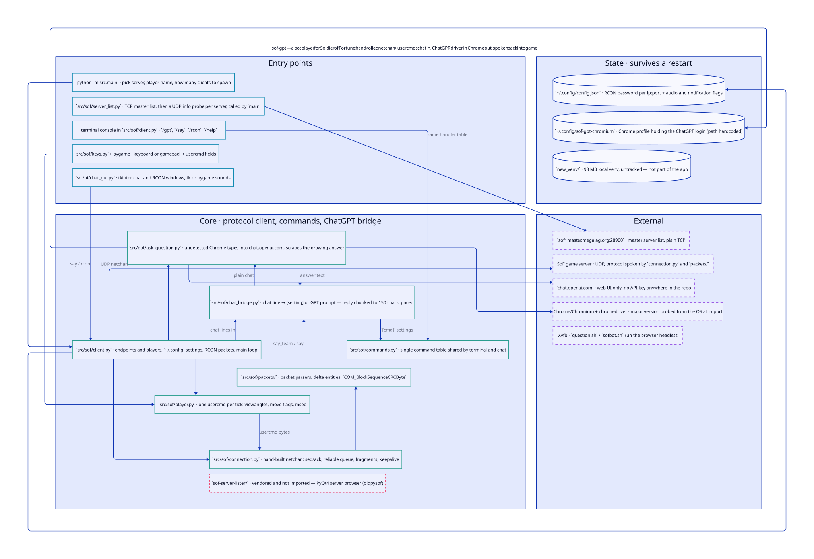

# sof-gpt, as it actually works

A bot player for Soldier of Fortune: a Python client that speaks the game's network protocol itself, reads in-game chat, and answers through ChatGPT running in a real browser.

## Read it left to right

- **No engine, no DLL — the netcode is re-implemented.** `connection.py` + `packets/` do what `qcommon` does in the game: sequence/ack bookkeeping, reliable queue, delta entities, `COM_BlockSequenceCRCByte`. The server cannot tell this client from a patched one, which is also why every protocol quirk lands here rather than in a mod.
- **Two front doors, one command table.** Terminal `/team 1` and in-game `[team_red_blue] 1` both dispatch into `commands.py`; chat lines that are not commands become GPT prompts instead. That single table is why `/help` can list everything honestly.
- **There is no OpenAI API key anywhere.** `gpt/ask_question.py` launches undetected Chrome, types into `chat.openai.com`, and polls the growing `.prose` element until the answer stops lengthening. The ChatGPT login lives in a Chrome profile whose path is hardcoded — that directory is the real credential.
- **Speaking is harder than thinking.** SoF flood-limits `say`, so answers are chopped to 150-character chunks and released on `base_delay + scaled_delay × len/150`, with the text colour toggled per line so consecutive chunks read as separate turns.
- **Most of the repo is not the bot.** `sof-server-lister/` is a vendored PyQt4 server browser that nothing imports, `new_venv/` is a 98 MB untracked venv; the live state is one `~/.config/config.json` (RCON passwords, audio flags) plus the Chrome profile.

---

Source of truth: [`docs/system.d2`](docs/system.d2) · re-render with [`scripts/render-diagram.sh`](scripts/render-diagram.sh) (`docs/system.svg` light+dark, `docs/system.png` dark 0.5× for gpm desktop).
